# FlashDrop

[](https://github.com/Linykq/FlashDrop/actions/workflows/ci.yml)
[](https://github.com/Linykq/FlashDrop/actions/workflows/nightly.yml)
[](LICENSE)


**A live-shopping flash-sale platform that sells a limited drop to a burst of buyers without overselling,
double-charging or losing an event, and proves it with machine-checked invariants.**

<picture>
  <source media="(prefers-color-scheme: dark)" srcset="docs/screenshots/home-dark.webp">
  
</picture>

<sub>A live drop mid-sale on the seeded stack. The buyers in this shot were test sessions driven through the
real API, and the stock line is updated over WebSockets.</sub>

A host goes live, a drop of a few hundred units opens, and thousands of buyers press Buy within seconds.
FlashDrop is built to stay correct under that burst: **no oversell, no double charge, no lost order events,
no stock leaked by abandoned checkouts and no buyer over the purchase limit.** Each guarantee is written down
as an invariant ([INV-1 to INV-9](docs/system-design.md#11-invariants-checked-by-pnpm-verifyinvariants)) and
checked by `pnpm verify:invariants` across Postgres, Redis, the payment ledger and Kafka after every load and
chaos run.

## Highlights

**Storefront, live room and real-time stock**
- Next.js 16 / React 19 storefront with server-rendered product pages: the raw HTML carries the title and the
  current stock (`tests/e2e/ssr.spec.ts`).
- A live room with an HLS stream (fragmented MP4, captions), a pinned drop card and a viewer count across both
  API instances.
- Stock updates over WebSockets, fanned out through Redis pub/sub from two gateway instances, coalesced to at
  most 10 frames per second per socket and versioned so a client never goes backwards.
- An accessible, keyboard-only checkout (WCAG 2.2 AA target): focus management, a screen-reader countdown that
  speaks at 2:00, 1:00, 0:30 and 0:10, a one-time +60 s extension and axe checks in every state.

**No oversell under burst traffic**
- An atomic Redis Function (Lua) checks the drop window, the per-user limit and the stock and takes a hold.
  Losers get an O(1) answer and never touch Postgres.
- Every winner becomes an order row under Postgres `CHECK` constraints, so Postgres is the hard backstop even
  if Redis is wrong.
- Idempotency keys on reserve and checkout: a double click, a retry or a reload gives one order.
- Unpaid holds expire on Postgres time and return their stock automatically, even with Kafka down.

**Checkout decoupled from fulfillment**
- Checkout is one compare-and-set plus a transactional outbox row; the request ends there with 202.
- A relay streams the outbox to Kafka (`orders.v1`, partitioned by product), and idempotent consumers run
  payment, inventory settlement and the live sales dashboard.
- A mock payment provider with timeouts, declines and timeout-after-success; a late charge is refunded by
  closing its reference, so no order is ever charged twice.

**LLM listing generator and the test suite**
- Product photos in, a Zod-validated draft out (title, description, highlights, attributes), with a repair
  loop and a human approving every listing. Default model `claude-sonnet-5-5`; CI runs on recorded fixtures.
- Vitest (unit, integration, system), Playwright with axe, k6 load tests written in TypeScript, and a chaos
  suite, all running in GitHub Actions.

## Architecture


**Redis admits, Postgres decides, Kafka carries the news, timers clean up.**

| Deployable | What it runs |
|---|---|
| `web` | Next.js storefront, live room, checkout, order pages and the admin UI. No database credentials: it reads and writes only through `api`. |
| `api-1`, `api-2` | Fastify REST `/api/v1` plus the WebSocket gateway (`API_ROLES=http,ws`), rate limiting. |
| `worker` | The outbox relay, the expiry sweeper, the drop scheduler and the Redis reconciler, each leader-elected with a Postgres advisory lock. |
| `listing` | The LLM listing jobs, apart from the loops above. |
| `consumers` ×2, `dashboard-consumers` ×2 | Kafka consumer groups `payment`, `inventory-settlement` and `sales-dashboard`. |
| `payment-mock` | A simulated payment provider with its own ledger. |
| `caddy` | The edge on `:8080`. |

All of them are built from two images (`web` and `node`) and run on PostgreSQL 17, Redis 8 and Kafka 4. One
`docker compose` file starts everything, locally and in CI.

## How correctness is guaranteed

- **Redis is never optimistic.** Redis takes stock before Postgres records the order and gives it back only
  after Postgres has committed the outcome, so Redis can show less stock than Postgres but never more. If it
  is ever wrong, the Postgres `CHECK (reserved + sold <= total)` refuses, the buyer gets a 409, and the
  reconciler rebuilds the drop.
- **One identity per intent.** `rid = uuidv5(userId:dropId:Idempotency-Key)` is both the Redis hold and the
  order's primary key, so duplicates collapse onto one row.
- **One linearization point per order.** Every status change is a compare-and-set on the order row that moves
  the counters and writes the outbox row in the same transaction. Payment vs. expiry and cancel vs. payment
  are decided there; the loser's charge is refunded.
- **Postgres owns every deadline.** Expiry, the settlement safety net and the orphan scan run from Postgres,
  never from Redis key expiry.
- **Self-healing.** After a Redis restart or wipe, the reconciler rebuilds each drop from Postgres under a
  per-drop lock and a generation fence, so an in-flight reserve can't be counted twice.
- **Machine-checked.** `verify:invariants` waits for the pipeline to go quiet, then checks INV-1 to INV-9. It
  runs after the E2E, load-smoke and system jobs in CI and after the nightly load and chaos runs, and any
  violation fails the job.

The full argument is in [`docs/system-design.md`](docs/system-design.md) §4–§6, and each major decision has an
[ADR](docs/adr/README.md).

## Screenshots

Captured from a freshly seeded stack on 1440×900 at 2× (phones at 390×844, 3×). The sale was driven through
the real API by 380 test buyers; the listing draft comes from the fixture provider, not a live model call.

| | |
|---|---|
| 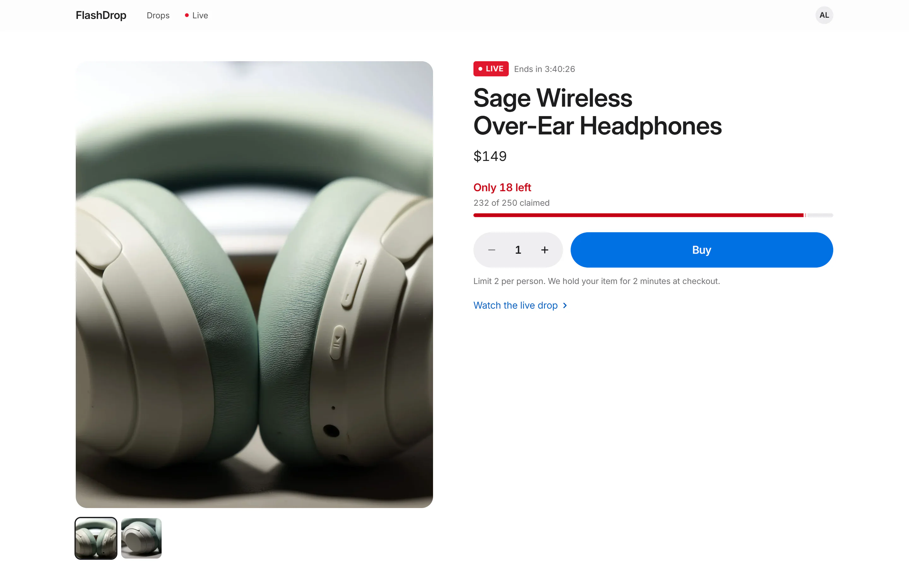 <br><sub>Product page mid-sale, with live stock</sub> | 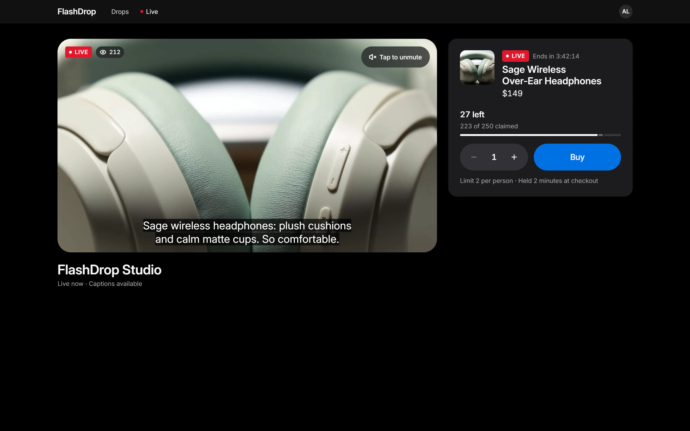 <br><sub>Live room: HLS stream with captions, pinned drop, viewer count</sub> |
| 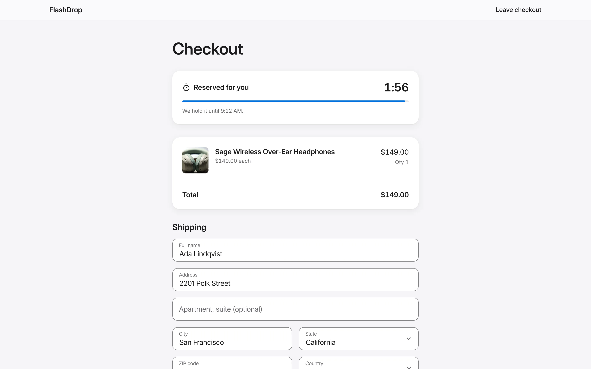 <br><sub>Checkout: the hold counts down; keyboard-only and screen-reader friendly</sub> | 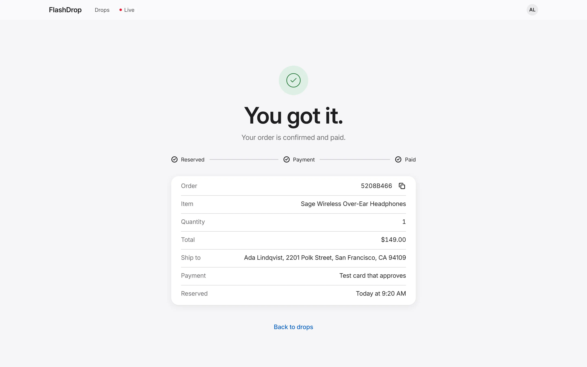 <br><sub>Order page: Reserved → Payment → Paid, pushed over WebSocket</sub> |
| 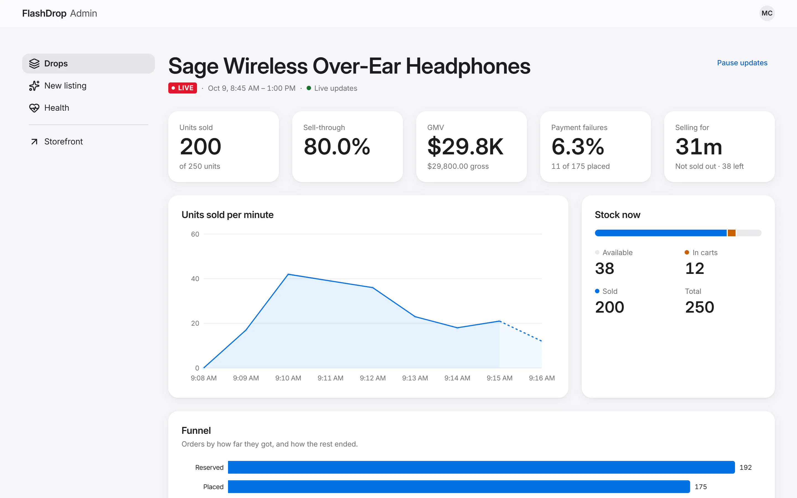 <br><sub>Live sales dashboard during the sale</sub> | 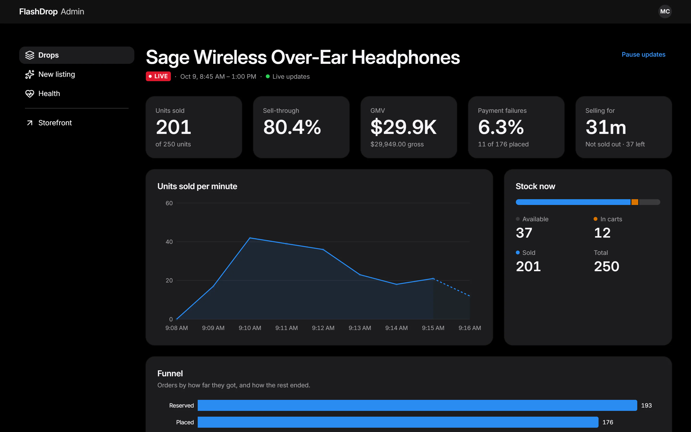 <br><sub>The same dashboard in dark mode</sub> |
| 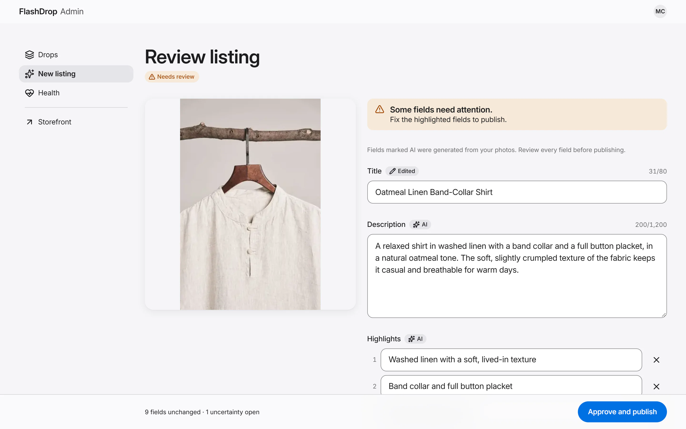 <br><sub>LLM listing review: AI-badged fields, an edited title (fixture provider)</sub> | 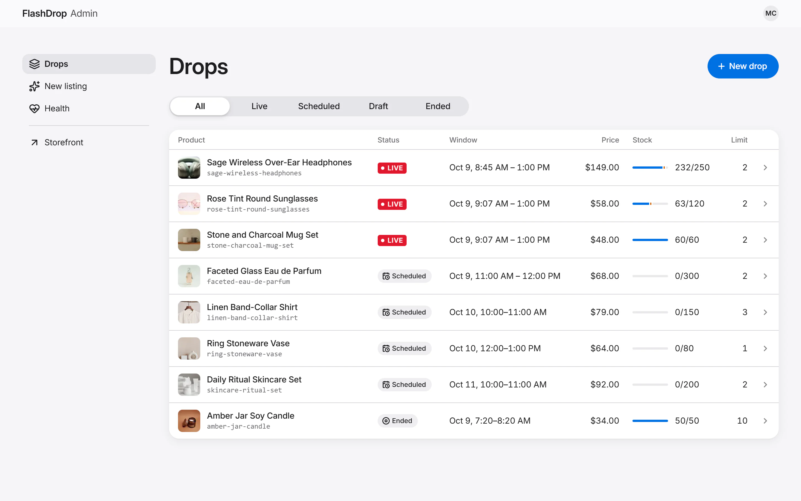 <br><sub>Admin: live, scheduled and ended drops</sub> |
| 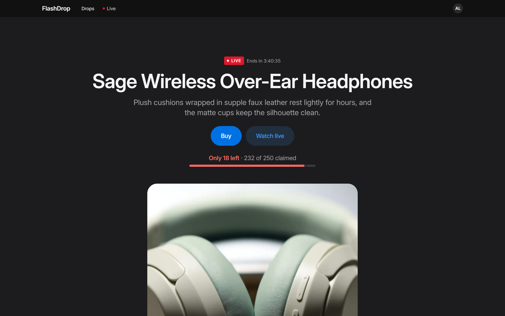 <br><sub>Home in dark mode</sub> | 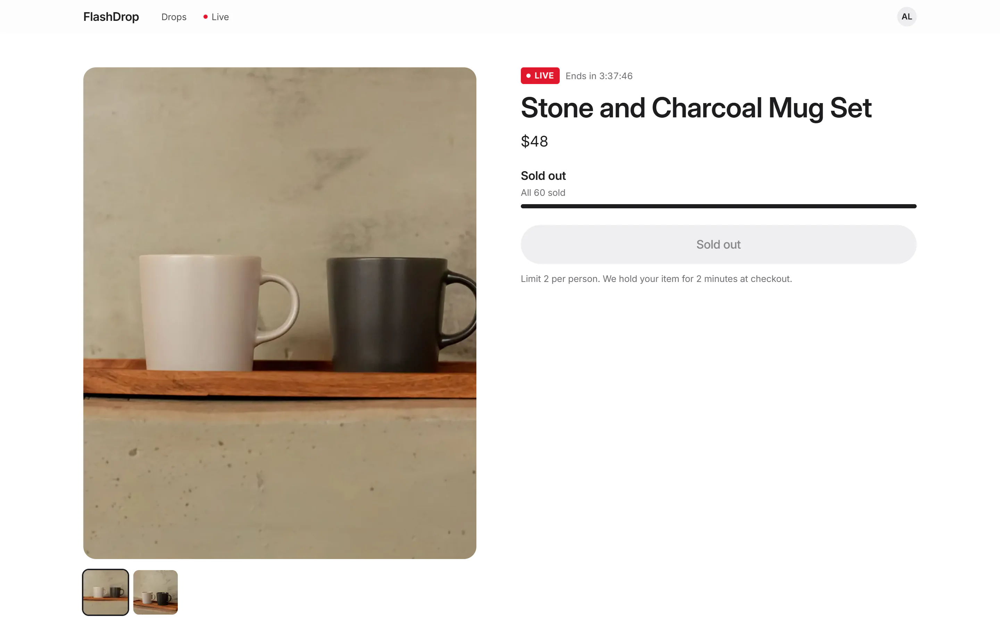 <br><sub>A sold-out drop</sub> |

<p>
  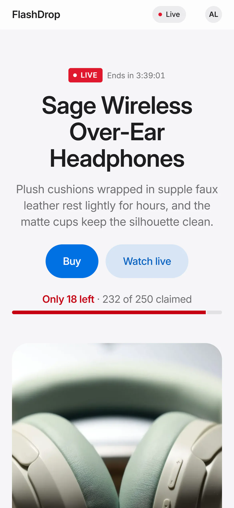
  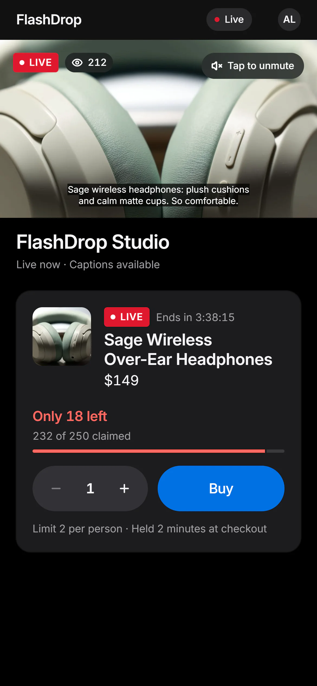
  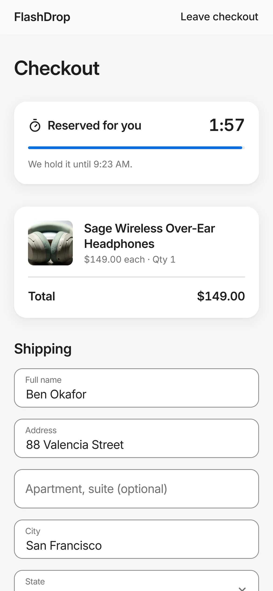
</p>

More: the [full home page](docs/screenshots/home-full-light.webp) and the
[full dashboard](docs/screenshots/admin-dashboard-full.webp).

## Measured performance

Measured on **one desktop (AMD Ryzen 5 5600, 6 cores / 12 threads, 32 GB, Windows 11, Docker Desktop) running
the whole Compose stack and k6**, two runs per scenario. Full method and evidence: [`docs/perf.md`](docs/perf.md).

| What | Result |
|---|---|
| Correctness under load | 0 oversell, 0 double charges, 0 lost events, 0 leaked units across 18 load runs (about 356k reserve requests, about 20k orders), checked by `verify:invariants` after every run |
| Reserve throughput, **reserve-only** profile | about 2,000 reserve requests/s from 10,000 buyers on 1,000 units, p95 23–71 ms; sold out in about 2 s |
| Full flash sale (checkout, payments, cancels running) | 600 req/s, 300 units, 3,000 buyers with an opening spike of 300 at once: reserve p95 30–35 ms |
| Losers never touch Postgres | sold-out answers from one Redis Function call, server p95 about 2 ms; Redis at 16–26 µs per call |
| Real time | 2,000 WebSockets across two gateways, stock propagation p95 132–144 ms (100 ms coalescing included), at most 9 frames/s per socket |
| Idempotency | 50 identical concurrent reserves → 1 hold; 20 identical checkouts → 1 order, 1 charge |
| Expiry | abandoned holds back in stock within about 1 s of expiry (1,000-unit soak, 3 rounds, nothing leaked) |

**Targets this machine did not meet** (perf §1, §3): reserve p95 < 100 ms in the full laptop profile (654–942
ms: the two API processes saturate at about 1,400 req/s once buyers poll their orders); winners' reserve p95
< 250 ms (0.73–0.92 s: every winner queues on the drop's single inventory row); submit → PAID p95 < 2 s (about
40 s laptop, 14–16 s nightly: a sale is one product, so its payments share one Kafka partition with 32 charges
in flight). These are trade-offs of the design, explained in [ADR 0007](docs/adr/0007-reserve-transaction-as-one-plpgsql-call.md)
and [ADR 0009](docs/adr/0009-one-topic-keyed-by-product.md).

## Quickstart

**Prerequisites:** Docker Desktop (or Docker Engine) with Compose v2 and buildx, and about 3 GB of memory for
the stack; Node.js 22.12 or later (`.nvmrc`); pnpm 10.32 (`corepack enable` picks the pinned version). Host
ports 5433, 6379, 6380, 9092 and 8080 must be free; everything binds to `127.0.0.1`.

```sh
pnpm install
pnpm stack:up        # builds the node and web images, then starts the whole stack and waits until it is healthy
pnpm demo:reset      # any time later: wipes Postgres, Redis, Kafka and uploads, then stack:up re-seeds drops around now
```

Open **http://127.0.0.1:8080**. Use `127.0.0.1`, not `localhost`: the API's Origin allowlist and the session
cookie are scoped to that host.

- **Sign in** at `/login` by picking a seeded user. Buyers: Ada Lindqvist, Ben Okafor, Chloé Martin, Dev Patel
  and Emi Tanaka. Admin: **Mira Chen**.
- **The seed** has one drop live now (the eau de parfum, 250 units, limit 2), two scheduled, one already sold out,
  and the live room at `/live/studio`.
- **Admin** (as Mira): `/admin/drops` to create, arm, pause, end, cancel and re-run drops; `/admin/listings/new` for the
  listing generator; `/admin/dashboard/<dropId>` for the live dashboard; `/admin/health` for the invariant
  checks, lags and drift.

`pnpm stack:down` removes the app containers and keeps the data stores; `pnpm infra:down` stops everything
(data stays in volumes). You don't write a `.env`: on its first run `pnpm stack:up` (or `pnpm infra:up`) puts
freshly generated secrets into the git-ignored `.env` (`tools/ensure-env.ts`), because `compose.yaml` ships no
default for any of them. `.env.example` documents every variable.

## Security model

FlashDrop is a **local demo, not a deployment**. It is safe on your own machine and nowhere else:

- **Keep it on loopback.** Every port binds to `127.0.0.1`. Never publish `8080` or the `tools` profile
  (kafka-ui, Prometheus, Grafana) on another interface, a tunnel or a reverse proxy: the stack trusts anyone
  who can reach it. Redis and Kafka have no authentication, Prometheus has no login and Grafana lets anonymous
  viewers in.
- **Sign-in is passwordless.** The dev login signs anyone in as any seeded user, the admin included. It runs
  only with `ENABLE_DEV_LOGIN=true` (the Compose stack and `.env.example` turn it on for this machine), and
  the api refuses that flag when an allowed origin is not `127.0.0.1`, `localhost` or `[::1]`.
- **Secrets are per machine.** `pnpm stack:up` generates them into `.env`; the repository holds none. Turn
  `ENABLE_TEST_ROUTES` on only for local E2E and load runs: the test routes mint sessions and drops.

A real deployment would need TLS at the edge with HSTS, `WS_ALLOWED_ORIGINS` and `PUBLIC_ORIGIN` set to the
`https://` origin, `TRUST_PROXY` set to the edge's address, a Secure session cookie (`COOKIE_SECURE`), a real
sign-in instead of dev login, and authenticated data stores on a private network. The full model is in
[`docs/system-design.md` §11](docs/system-design.md#11-security--abuse-basics).

## Demos

Load and E2E runs need the test routes and the load profile's rate limits:

```sh
ENABLE_TEST_ROUTES=true RATE_LIMIT_IP_PER_SEC=100000 RATE_LIMIT_USER_PER_SEC=1000 pnpm stack:up
```

| Command | What you see |
|---|---|
| `pnpm demo:burst` | Creates a fresh drop that opens 20 s later and prints its product page and live dashboard URLs (`burst: live dashboard http://127.0.0.1:8080/admin/dashboard/<dropId>`). Open the dashboard as Mira, or the product page, before the sale starts. Then k6 fires 2,000 reserves from 300 buyers at 100 units in about 10 s, with checkouts, payments and cancels behind them, and `verify:invariants` runs: exactly 100 holds, nobody over the limit, every invariant green. `pnpm load:burst -e OPEN_DELAY_S=<seconds>` gives any profile the same lead time. |
| `pnpm load:burst -e PROFILE=laptop` | The full laptop burst: 10,000 buyers, 1,000 units, 2,000 reserves/s, checkout, payments and cancels. |
| `pnpm verify:invariants [--drop <id>]` | Waits for quiescence, checks INV-1 to INV-9 across Postgres, Redis, the PSP ledger and Kafka, and writes `invariants-report.json`. |
| `pnpm dash:rebuild --compose --wait` | Wipes the dashboard projection, replays `orders.v1` from the earliest offset and shows the totals converge to identical numbers. |
| `pnpm chaos:all` | Six failure scenarios on an isolated stack (`flashdrop-sys`, other ports), about 15 minutes: `redis-restart`, `redis-lost-tail`, `relay-kill`, `consumer-kill`, `psp-outage`, `dup-delivery`. Each ends in `verify:invariants`. Run one with `pnpm chaos:<name>`. |
| `docker kill flashdrop-consumers-1` | A consumer group rebalances mid-sale; nothing is lost or charged twice. |
| `docker compose --profile tools up -d kafka-ui` | Kafka UI on http://127.0.0.1:8081 (read-only; user `admin`, password `KAFKA_UI_PASSWORD` from `.env`): `order.*` events keyed by `productId`. |
| `docker compose --profile tools up -d prometheus grafana` | Grafana on http://127.0.0.1:3001 with the FlashDrop dashboard. |

In Git Bash on Windows, prefix the k6 commands with `MSYS_NO_PATHCONV=1`, or Git Bash rewrites `/scripts/...`
into a Windows path. `pnpm chaos:all` needs the images (`docker buildx bake --file docker-bake.hcl --load`);
`compose.isolated.yaml`'s header has the command that removes the isolated stack afterwards.

## Testing

| Layer | Tool | Size | Command | In CI |
|---|---|---|---|---|
| Unit | Vitest | 1,384 tests in 131 files | `pnpm test` | `static` |
| Integration | Vitest against Compose Postgres, Redis and Kafka | 509 tests in 47 files | `pnpm infra:up && pnpm test:int` | `integration` |
| System | Vitest against a running stack, with failure injection | 7 tests in 6 files | `FD_SYSTEM_TESTS=1 pnpm test:system` (isolated stack, see `compose.isolated.yaml`) | `system` |
| End to end | Playwright + axe-core | 110 tests in 19 specs | `pnpm e2e:install && pnpm test:e2e` | `e2e` |
| Load | k6, TypeScript scripts | `burst`, `idempotency-storm`, `expiry-soak`, `ws-fanout`; `ci`, `nightly` and `laptop` profiles | `pnpm load:burst`, `pnpm load:ws-fanout`, … | `load-smoke`; nightly |
| Invariants | `tools/verify-invariants.ts` | INV-1 to INV-9 | `pnpm verify:invariants` | after `e2e`, `load-smoke`, `system`; nightly |
| Chaos | `tests/chaos` driving Docker Compose | 6 scenarios | `pnpm chaos:all` | nightly |

Counts as of 2026-10-09. Highlights: 2,000 concurrent reserves from 300 users on 100 units give exactly 100
holds; a fast-check model test drives the Redis Functions against a pure TypeScript model; a race matrix
forces payment vs. expiry, cancel vs. payment, rebuild vs. reserve and tombstone vs. late insert in both orders;
a keyboard-only purchase is asserted focus by focus, with `page.clock` fast-forwarding the countdown.

**CI** ([`ci.yml`](.github/workflows/ci.yml)) runs on every pull request and every push to `main`: `static` (lint, typecheck, unit tests,
build), `integration`, `e2e`, `load-smoke` (k6 plus invariants, with a step summary) and `system`. Correctness
is a hard gate; CI latency is only a smoke signal on a shared 4-vCPU runner. **Nightly**
([`nightly.yml`](.github/workflows/nightly.yml)) runs the nightly k6 profile, the six chaos scenarios and the
invariants on the isolated stack and uploads the reports.

## LLM setup

The listing generator runs on **recorded fixtures by default**, so the stack, the tests and CI need no API key
and cost nothing. To use a live model:

```sh
# .env (git-ignored)
LLM_PROVIDER=anthropic
ANTHROPIC_API_KEY=sk-ant-...
LISTING_MODEL=claude-sonnet-5-5   # the default; claude-haiku-4-5 (cheap) and claude-opus-5-5 also work
```

then `pnpm stack:up` again. In the Compose stack a key alone never switches the provider, so a test run never
spends money by accident; under `pnpm dev`, an empty `LLM_PROVIDER` uses Anthropic whenever a key is set.
`pnpm eval:listings` (manual, needs a key) scores the prompt on known-answer photos, and the manual
[`llm-eval.yml`](.github/workflows/llm-eval.yml) workflow is the only one that uses the key as a secret.

## Development loop

```sh
cp .env.example .env
pnpm infra:up                     # Postgres on 127.0.0.1:5433, Redis on :6379 (+ :6380 for tests), Kafka on :9092
pnpm db:migrate && pnpm db:seed
pnpm dev                          # web :3000, api :4000, worker, consumers, payment-mock :4100, with hot reload
```

| Command | What it does |
|---|---|
| `pnpm lint` / `pnpm format` | Biome checks, or fixes |
| `pnpm typecheck` | TypeScript across every package |
| `pnpm db:reset-dev` | Fresh development database and Redis, then the seed |
| `pnpm dlq:replay` | Replays dead letters inside the stack's network (`--only`, `--from-offset`, `--dry-run`) |
| `pnpm docs:diagrams` | Re-renders `docs/diagrams/*.svg` from their Mermaid sources |

## Project structure

```
apps/
  web/            Next.js 16: storefront, live room, checkout, orders, admin
  api/            Fastify REST /api/v1 + WebSocket gateway, rate limits, admin and test routes
  worker/         relay, sweeper, reconciler, listing and the consumers (payment, settlement, dashboard), chosen per process by WORKER_ROLES
  payment-mock/   simulated PSP with a ledger in its own schema
packages/
  contracts/      Zod: HTTP DTOs, the OrderEvent envelope, the WS protocol, ListingWire/ListingDraft
  domain/         order state machine, rid and fingerprints, typed errors
  db/             Drizzle schema, SQL migrations (incl. PL/pgSQL), guarantee-carrying queries
  inventory/      the Redis Functions library (flashdrop.lua), drop lock, rebuild, drift checks
  messaging/      Kafka producer, consumer runner, outbox relay
  llm/            listing providers (Anthropic, fixture, recording), prompt, repair loop
  config/         Zod env loading, pino logger, shared constants
  test-utils/     the integration tests' infra probe (test factories and hooks live in db/src/test-*.ts)
tests/            e2e/ (Playwright)  load/ (k6)  chaos/  fixtures/
tools/            verify-invariants, dash-rebuild, seed, eval-listings, system tests
infra/            Caddy, Redis, Kafka, Dockerfiles, Prometheus, Grafana
docs/             system design, design flow, ADRs, perf, design system, interview notes
```

## Documentation

- [`docs/system-design.md`](docs/system-design.md): the source of truth, with the §18 traceability matrix from
  each claim to its test.
- [`docs/design-flow.html`](docs/design-flow.html): a visual walkthrough of the design (open it in a browser).
- [`docs/adr/`](docs/adr/README.md): one record per major decision.
- [`docs/perf.md`](docs/perf.md): measured performance, the machine, the method and the bottlenecks.
- [`docs/design-system.md`](docs/design-system.md): tokens, typography, components and accessibility rules.
- [`docs/interview-notes.md`](docs/interview-notes.md): the design explained in 30 seconds and in 2 minutes,
  the hardest bugs, trade-offs and likely questions.
- [`docs/spikes/m0.md`](docs/spikes/m0.md): the M0 spike that verified library behaviour before building.

## License

[MIT](LICENSE). Product photos are from Pexels under the Pexels License, credited in
[`assets/catalog/CREDITS.md`](assets/catalog/CREDITS.md).
